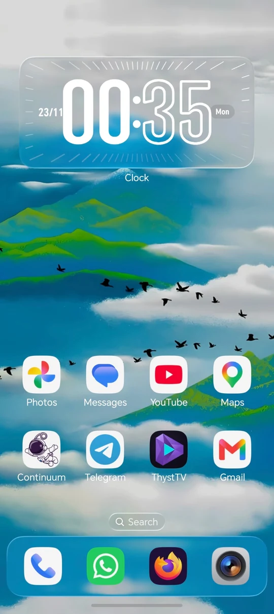
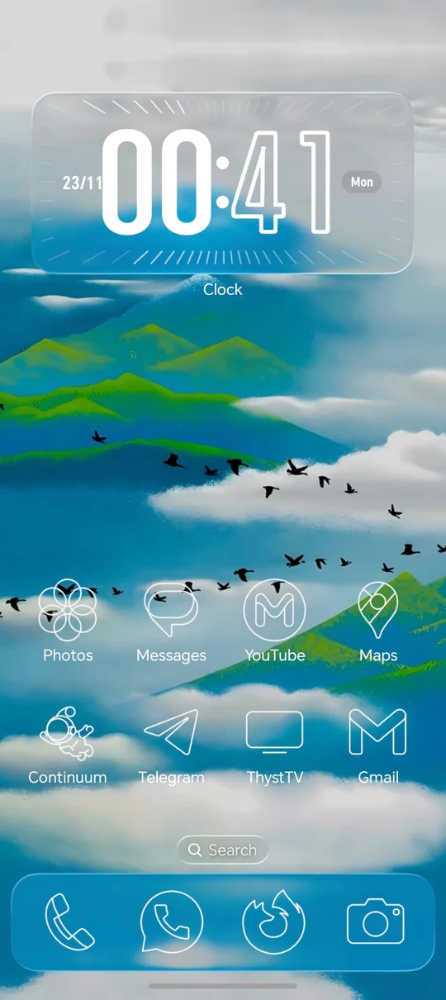
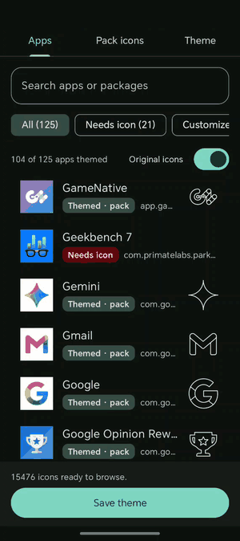
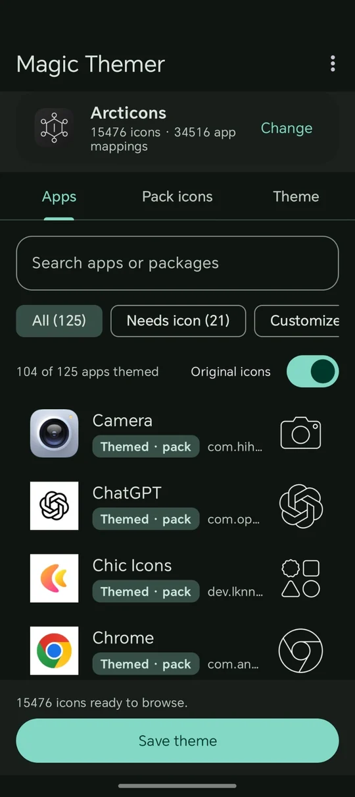
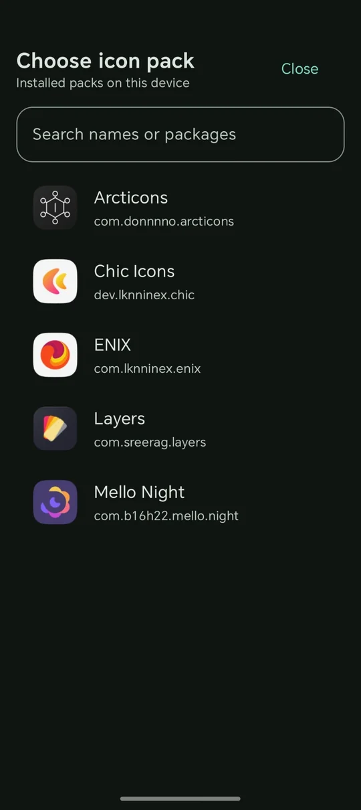
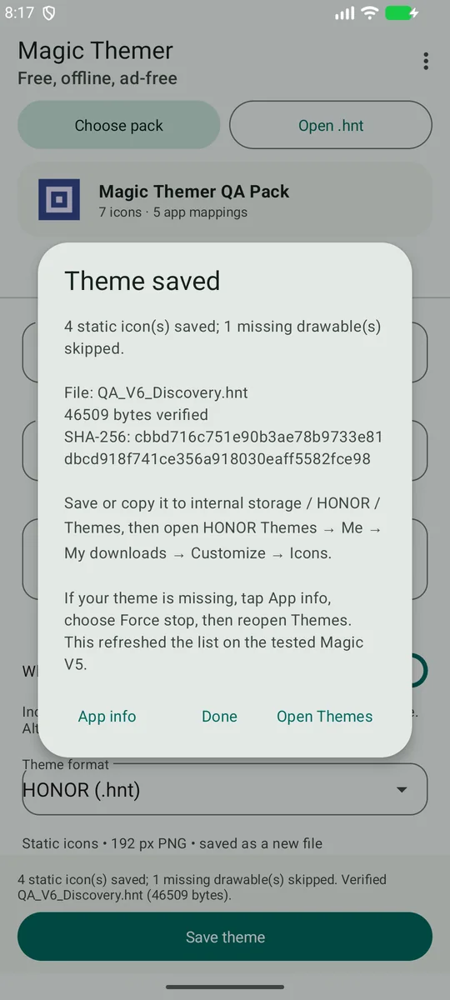
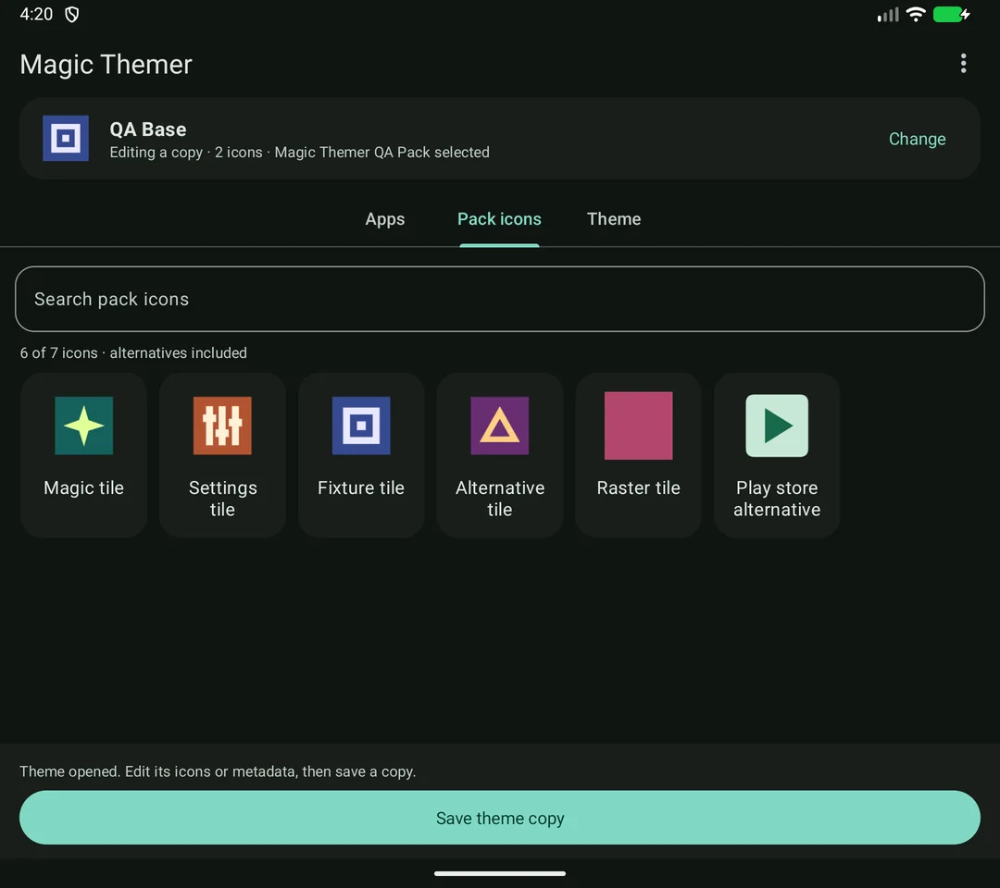

<div align="center">


# Magic Themer

**Turn the Android icon packs you already have into HONOR / MagicOS icon themes.**  
Free, offline, and open source — no ads, accounts, analytics, or network access.

[**Project Website**](https://tzii.github.io/magic-themer/) · [**Download APK (v0.7.1)**](https://github.com/tzii/magic-themer/releases/latest) · [**Changelog**](CHANGELOG.md) · [**GNU GPL v3.0**](LICENSE)

[](https://github.com/tzii/magic-themer/actions/workflows/ci.yml)

</div>

---

HONOR Themes doesn't support third-party icon packs. **Magic Themer** reads an installed pack, helps you fill gaps and pick alternatives app by app, and saves a real `.hnt` theme you apply straight through HONOR Themes → **Customize → Icons**. It can also edit the icons and metadata of an existing local theme while preserving its other modules and always saving a new copy.

## Real phone results & live demo

| Before (Stock MagicOS) | After (Arcticons via Magic Themer) | Filling a gap in seconds |
| :---: | :---: | :---: |
|  |  |  |

<p align="center">
  <sub>Captured on an <b>HONOR Magic V5 (MagicOS 10)</b> with the open-source Arcticons pack — no third-party launcher needed.<br>Try the interactive before/after slider and walkthrough on the <a href="https://tzii.github.io/magic-themer/">project website</a>.</sub>
</p>

## Inside the app

| Original icons & live matching | Installed pack picker | SHA-256 verified save | Foldable & dark mode |
| :---: | :---: | :---: | :---: |
|  |  |  |  |

## Features

- **Reads your installed packs** — supports common Android launcher formats (Nova, ADW, Lawnchair, Smart Launcher, and others).
- **Whole pack or installed apps only** — export every app the pack knows about (including apps you haven't installed yet) or only what's on your phone.
- **Style unmatched apps & live calendar** — optionally exports a pack's mask, backgrounds and overlay (`icon_mask.png`, `icon_background_*.png`, `icon_border.png`) plus HONOR's live calendar background and date color when the pack defines them.
- **Smart gap filling & icon requests** — **Needs icon** lists uncovered apps, suggests matching icons by name or category, and lets you share the remaining list as a ready-to-send icon request for pack authors.
- **Original icons toggle** — preview each app's real icon instead of your currently active theme's icon so you can see what a theme actually covers.
- **Forgiving search** — searches across apps and pack artwork even with typos, split words, or initials.
- **Non-destructive `.hnt` editing** — opens existing ordinary `.hnt` themes to edit icons, name, designer, and description while keeping wallpapers, fonts, and other modules intact. Always saves a new copy; the original is never overwritten.
- **Verified exports** — reads saved themes back and verifies file size and SHA-256 checksum before reporting success.
- **Honest about limits** — flags apps HONOR can't theme (such as builds renamed after compilation).
- **Adaptive, multilingual & private** — English and Italian translations, light and dark themes, responsive layouts for foldables, tablets, and landscape, ~1.6 MB APK, zero internet permission.

## Install

1. Download the latest APK (and optional SHA-256 checksum) from [**Releases**](https://github.com/tzii/magic-themer/releases/latest) and install it (requires **Android 8.0+**).
   - **Obtainium:** add `https://github.com/tzii/magic-themer` to track GitHub Releases automatically.
   - **IzzyOnDroid / Fastlane:** store-listing metadata lives in `fastlane/metadata/android/`.
2. Install any icon packs from Google Play as usual. Magic Themer only reads packs already on your phone; it does not download or unlock paid packs.

> [!NOTE]
> **Upgrading from v0.7.0 or earlier:** From v0.7.1, the Android application ID is `com.tzii.magicthemer`. Android installs it alongside the older `dev.magicthemer` app so both can coexist. Export any themes you want to keep from the old app, then open them in the new one. Saved settings and assignments do not transfer automatically. Public releases continue to use the same permanent signing key.

## Make a theme

1. Tap **Choose pack** and pick an installed icon pack.
2. In **Apps**, use **Needs icon** to spot gaps. Tap an app to choose a suggested icon or search the pack. **Pack icons** browses all artwork in the pack, including alternatives.
3. In **Theme**, check the name, designer, and description. Keep **Whole icon pack** on to include apps you haven't installed yet, or turn it off to export installed apps only.
4. Tap **Save theme** and save into internal storage → `HONOR/Themes` (or `Downloads`, then move it there with Files).
5. Open **HONOR Themes** → **Me → My downloads**, then **Customize → Icons** and apply your theme.

> [!TIP]
> **Theme not showing up in HONOR Themes?** Tap **App info** in the save dialog, choose **Force stop**, then reopen HONOR Themes.

### Edit an existing theme

Use **Open .hnt** (or **Open theme file** in the menu). Selecting an icon pack doesn't change an imported theme until you assign icons or tap **Apply whole pack to theme**. Saving always creates a new file; the original is never overwritten.

## Compatibility & limitations

- Tested on an **HONOR Magic V5, MagicOS 10** (EU). Other HONOR and Huawei devices may work but are untested.
- Icons are exported as `192 × 192` px PNGs. Pack fallback masks/backgrounds and live calendar icons are experimental and can be toggled in the **Theme** tab; dynamic clocks are exported as static icons.
- HONOR themes one icon per app package, so apps with multiple launcher activities share one icon.
- New wallpapers, fonts, lock screens, and system UI can't be created; imported ones are preserved when editing an existing theme.
- Encrypted, signed, or otherwise unusual theme formats aren't supported.
- Icon artwork belongs to its creators. Keep themes made from packs for personal use unless the pack's author allows sharing.

## Build from source

Requirements: **Android SDK Platform 37** and **JDK 17+** (Android Studio's bundled JBR works).

```powershell
$env:JAVA_HOME = 'C:\Program Files\Android\Android Studio\jbr'
$env:ANDROID_HOME = "$env:LOCALAPPDATA\Android\Sdk"
.\gradlew.bat :app:assembleDebug :app:testDebugUnitTest :app:lintDebug
```

On macOS or Linux, run `./gradlew` with the same tasks. The debug APK is written to `app/build/outputs/apk/debug/app-debug.apk`.

[GitHub Actions](https://github.com/tzii/magic-themer/actions/workflows/ci.yml) runs these tasks, an unsigned R8 release build and the `:qa:iconpack` fixture build on every pull request and every push to `main`. Each run keeps its debug APK and test and lint reports as artifacts for 14 days. That APK is signed with the runner's throwaway debug key, so it can't update a debug build installed from your own machine; uninstall that one first.

For a signed release build, copy `keystore.properties.example` to `keystore.properties`, fill it in, and run `:app:assembleRelease`. Without that file the release APK is left unsigned. Keystores and `keystore.properties` are ignored by Git.

### Documentation

- [Project website](https://tzii.github.io/magic-themer/) (`docs/index.html`)
- [Publishing & release verification](docs/RELEASING.md)
- [Validation procedure](docs/VALIDATION.md) (`:qa:iconpack` is an original synthetic pack used for emulator tests, not bundled in the app)
- [HONOR theme format & engine research](docs/RESEARCH.md)

## License

Magic Themer is free software under the [GNU General Public License v3.0](LICENSE). See [CHANGELOG.md](CHANGELOG.md) for version history. Not affiliated with HONOR.
